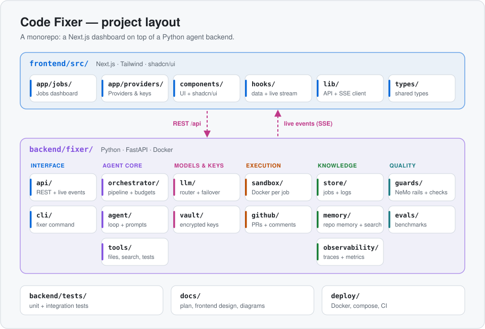

# Code Fixer Agent

An autonomous agent that connects to GitHub repos, reproduces reported bugs in a sandbox, fixes them, runs the tests until they pass, and opens a pull request explaining the fix. It's designed to run **nearly free** on free-tier LLM providers.

> **Status:** the agent works end to end on local repos from the CLI (phase 03, Orchestration, is in progress: GitHub PRs and the Docker sandbox are next). The dashboard (phase 01) runs on mock data. See [Plan.md](Plan.md) for the full design.

## Quick start

```bash
cd backend
cp .env.example .env          # then add at least one free key, e.g. FIXER_OPENROUTER_API_KEY
uv sync
uv run fixer providers test   # checks each key and that tool calling works
uv run fixer run --repo evals/bugs/py_cart --issue-file evals/bugs/py_cart/ISSUE.md
```

The agent works on a private copy of the repo and never edits yours. It prints the verified diff and saves a patch; add `--apply` to apply it.

## Build roadmap

<p align="center">
  <picture>
    <source media="(prefers-color-scheme: dark)" srcset="docs/assets/build-roadmap-dark.svg">
    
  </picture>
</p>

Each rung is a milestone. The ladder is updated as phases are finished.

## How the agent works

<p align="center">
  <picture>
    <source media="(prefers-color-scheme: dark)" srcset="docs/assets/harness-ladder-dark.svg">
    
  </picture>
</p>

For every bug, the agent climbs these steps one at a time and only moves up when the current step passes. When a check fails, it loops back down (A–D) instead of shipping a bad fix. Steps marked **code** use no LLM requests, which keeps the agent within free-tier limits.

<details>
<summary><b>Loops and guardrails</b></summary>

| Loop | From → To | When |
|---|---|---|
| A | Verify → Fix loop | The full suite shows new failures |
| B | Review → Fix loop | The critic or the test-tamper guard rejects the diff |
| C | Feedback → Fix loop | A reviewer comments, or CI goes red on the PR |
| D | Fix loop → Localize | Stuck: the same failure repeats N times |

On every step: request and time budgets, stuck detection, automatic provider failover, and a written report if the agent gives up.
</details>

## Agent orchestration

<p align="center">
  <picture>
    <source media="(prefers-color-scheme: dark)" srcset="docs/assets/agent-orchestration-dark.svg">
    
  </picture>
</p>

The orchestrator is plain code. It never shares one long conversation between agents; each agent gets a small, task-specific context and a narrow set of tools:

| Agent | Runs | Model | Gets |
|---|---|---|---|
| **Context pack** | always | none (code) | exact source of the functions the issue names, plus the nearest test file |
| **Scout · tests**, **Scout · code** | in parallel, only if the pack is weak | cheap/fast (e.g. Groq `gpt-oss-20b`) | one question each; return a short brief |
| **Reproducer** | once | main model | issue + pack/briefs → writes the failing test |
| **Fixer A**, **Fixer B** | staggered race in separate sandboxes, each on a different provider | main model | issue + pack + failing test; B starts only if A is still stuck after 5 turns |
| **Verify gate** | per fixer | none (code) | first fix that passes the full suite wins; the others stop |
| **Critic** | once | main model | the diff |

**Why it's cheaper:** exploration doesn't pile up in the expensive agents' context, the plain-code steps cost no requests, and parallel agents only start when they're likely to help. Measured on the same bug with the same model (Groq `gpt-oss-120b`):

| Mode | Requests | Input tokens | Time |
|---|---|---|---|
| Classic single agent (`--no-context-pack --scouts never --candidates 1`) | 21 | 24.9K | 126 s |
| **Orchestrated (default)** | **9** | **13.0K** | **69 s** |
| Everything in parallel (`--scouts always --candidates 2 --stagger 0`) | 27 | 35.3K | 170 s |

Running everything in parallel costs the most on an easy bug; it's there for hard ones. Every run prints requests and tokens per agent.

## Project layout

<p align="center">
  <picture>
    <source media="(prefers-color-scheme: dark)" srcset="docs/assets/project-layout-dark.svg">
    
  </picture>
</p>

<details>
<summary><b>Folder tree</b></summary>

```
frontend/src/        Next.js dashboard
  app/jobs/          Jobs dashboard
  app/providers/     Providers & keys
  components/        UI + shadcn/ui
  hooks/             data + live stream
  lib/               API + SSE client
  types/             shared types
backend/fixer/       Python agent
  api/  cli/                          interface
  orchestrator/  agent/  tools/       agent core
  llm/  vault/                        models & keys
  sandbox/  github/                   execution
  store/  memory/  observability/     knowledge
  guards/  evals/                     quality
backend/tests/       unit + integration tests
docs/                plan, frontend design, diagrams
deploy/              Docker, compose, CI
```
</details>

## Planned features

- CLI first: `fixer run --repo owner/name --issue 123`
- Supports Python, JavaScript/TypeScript and Java repos
- A Docker sandbox per job, with no network during test runs and no secrets inside the container
- **Multiple free LLM providers:** OpenRouter, Gemini, NVIDIA, Groq, Mistral, Ollama, or any OpenAI-compatible endpoint. You choose the primary provider and the fallback order. If a key expires, credits run out or a daily quota is hit, the agent switches to the next provider automatically, even mid-job.
- **Secure key vault:** API keys are stored encrypted (AES-256-GCM) in a local SQLite DB, with the master key in your OS keychain. Keys are never logged and never passed into the sandbox.
- **Local web dashboard** (Next.js): live jobs view and a page to manage providers and keys
- Budgets on LLM requests, iterations and time, plus stuck detection
- Full trajectory logs so every run can be replayed
- Later: a GitHub App with webhook triggers, a PR review-comment loop and parallel candidate fixes

## Requirements

- Python 3.12+ and [uv](https://docs.astral.sh/uv/)
- git and ripgrep (`rg`)
- At least one free LLM API key (OpenRouter recommended; Groq works well as a fast fallback)
- Docker for the isolated sandbox (on macOS: `brew install colima docker && colima start`). Until then, `--sandbox local` runs tests in a private copy on your machine with no isolation, so only use it on repos you trust.
- Later: a GitHub token with repo access (for opening PRs)

## Providers and keys

Today, keys come from `backend/.env` (git-ignored); the encrypted vault and `add`/`rotate-key` commands arrive with the backend (phase 02).

```bash
uv run fixer providers list    # providers with a key, fallback order, masked keys
uv run fixer providers test    # live check: key valid, model reachable, tool calling works
uv run fixer doctor            # git, ripgrep, uv, docker, keys
```

Free tiers to know about: OpenRouter allows 50 free requests/day (1,000/day after a one-time $10 top-up); Groq's free tier caps tokens per minute, so the router paces requests and waits out short limits automatically.

## Docs

- [Plan.md](Plan.md): architecture, pipeline, LLM provider research, features, roadmap
- [docs/frontend.md](docs/frontend.md): frontend design, wireframes and the API it needs
- Diagrams are generated by [`docs/assets/build_diagrams.py`](docs/assets/build_diagrams.py). Edit the lists at the top of that file and re-run it.
